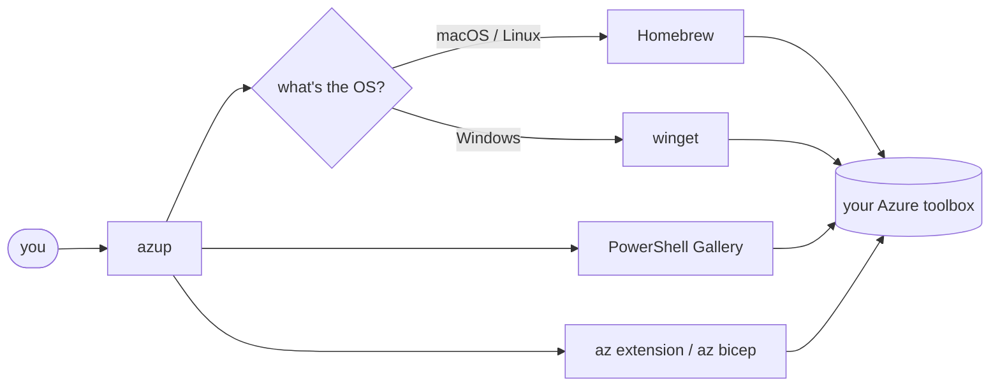

<p align="center">
  
</p>

<p align="center">
  <a href="https://github.com/saeid-adz/azup/releases"></a>
  
  
  
  <a href="LICENSE"></a>
</p>

<h3 align="center">One command to install, update and sanity-check everything an Azure engineer needs.<br>Comes with a small blue robot.</h3>

<p align="center">
  
</p>

---

## Why does this exist?

Because this is not a personality:

```sh
brew upgrade azure-cli azd && pwsh -c "Update-Module Az, Microsoft.Graph" && az extension update --name resource-graph && az bicep upgrade && …
```

…and then doing it all again on your Windows laptop, your Ubuntu jump box, and the Mac you swore you'd never touch.

**azup** keeps your Azure toolbox in one place:

- 🧰 **Everything in one list** – Azure CLI, `azd`, Bicep, Az PowerShell, Microsoft Graph SDK, Entra PowerShell, `az` extensions, Foundry / AI tooling, kubectl, kubelogin, AzCopy, Terraform and friends
- ✅ **One checklist** – tick what you want, azup installs the missing and updates the outdated
- 🖥️ **Windows, macOS, Linux** – same commands everywhere (winget / Homebrew / PowerShell Gallery under the hood)
- 🩺 **`azup doctor`** – are you actually signed in to `az`, `azd`, Az PowerShell and Graph? (Finally, an answer.)
- 🪶 **Zero dependencies** – a single Python file. No `pip install` rabbit holes.
- 🤖 **Azzy** – a tiny blue robot who blinks, tells jokes while you wait, and throws confetti when you're done

## Install

**macOS / Linux**

```sh
curl -fsSL https://raw.githubusercontent.com/saeid-adz/azup/main/install.sh | sh
```

**Windows** (PowerShell – installs Python via winget if you don't have it)

```powershell
irm https://raw.githubusercontent.com/saeid-adz/azup/main/install.ps1 | iex
```

**Any OS with pipx** (from PyPI)

```sh
pipx install azup-cli
```

The package is called `azup-cli`; the command is still `azup`. Windows users can also download a standalone `azup.exe` from the [releases page](https://github.com/saeid-adz/azup/releases).

Open a new terminal and type `azup`. That's the whole setup. (Yes, really. Go get a coffee, or don't – we're not your manager.)

> **Want to pin a version?** Installs from a release tag are immutable: `curl -fsSL https://raw.githubusercontent.com/saeid-adz/azup/main/install.sh | AZUP_BRANCH=v2.7.0 sh` (PowerShell: set `$env:AZUP_BRANCH = 'v2.7.0'` first).

> Prefer to read before you pipe to a shell? Good instincts. [`install.sh`](install.sh) and [`install.ps1`](install.ps1) are short and boring on purpose.

## 30-second tour

```sh
azup                          # interactive menu (Azzy will suggest what to do)
azup select                   # the checklist: tick, enter, done
azup status                   # what's installed, what's outdated
azup install --profile core   # az, azd, Bicep, PowerShell, Az, Graph, resource-graph
azup update                   # update everything that's outdated
azup doctor                   # sign-in + health checks
azup login all                # az, azd, Az PowerShell and Graph sign-in in one go
azup changes                  # release notes for everything that's outdated
azup update --changes         # read the notes first, then decide
azup nudge enable             # "3 tools outdated" when you open a terminal
azup schedule enable          # update automatically (weekly, Mondays 09:00)
azup whoami                   # who am I signed in as, in every tool?
azup ctx                      # switch subscription everywhere at once (type to filter)
azup install --profile ai     # core + Foundry / AI tooling
azup install --all -j 6       # everything, up to 6 things at once (default 4; -j 1 = one at a time)
azup self-update              # update azup itself
azup joke                     # you've earned it
```

Add `-n/--dry-run` to see exactly what would run (changes nothing) and `-y/--yes` to skip the "Proceed?" prompt.

### The checklist

```text
  Select components to install / update
  CLI
   ◉ Azure Developer CLI     1.25.4 → 1.37.3  azd up / templates
   ○ Azure CLI               2.86.0 ✔         az command line
   ○ kubelogin               not installed    Entra auth for AKS
  POWERSHELL
   ◉ Az PowerShell           16.2.0 → 16.5.0  Azure PowerShell module
   ○ Microsoft Graph SDK     not installed    Graph API v1.0 cmdlets
  ↑/↓ move · space toggle · a all · n none · u outdated · m missing · c core · enter confirm · q cancel
```

Missing → **install**. Outdated → **update**. Already fine → left alone. You always get a plan and a "Proceed?" before anything happens.

## Fast: installs and updates run in parallel

`azup install` and `azup update` don't wait in line. Work is split into **lanes**, one per backend, that run side by side while a live board shows every task:

```text
  » 12 tasks · 5 lanes in parallel  6 running · 5/12 done
   ✔ Azure CLI               brew        3s  done
   ⠧ Functions Core Tools    brew        3s  ==> Downloading azcopy
   ⠧ AzCopy                  brew        3s  ==> Downloading azcopy
   ✔ Az PowerShell           pwsh        4s  done
   ⠧ Microsoft Graph Beta    pwsh        1s  Installing Microsoft.Graph.Beta ...
   ◌ ext: resource-graph     az              waiting for Azure CLI
   ○ Bicep                   az              queued
  ▕███████░░░░░░░░░░░▏ 5/12
```

It's fast *and* safe, because not everything can run at once:

- **Homebrew** formulas are installed in a single `brew` call, so Homebrew downloads them in parallel itself (and azup retries one by one if the batch fails).
- **PowerShell modules** use two lanes: `Az` runs alongside `Microsoft.Graph*` / `Entra` (which share dependencies and so stay in order).
- Things that **need another tool wait for it**: modules wait for PowerShell, `az` extensions for Azure CLI, `azd` extensions for `azd`. If that tool failed, they say so instead of failing mysteriously.
- Anything that **may ask you something** (a password for a macOS cask, trusting a Homebrew tap) runs one at a time with a real terminal, never hidden in the background.

In a test with realistic delays, a 12-tool install dropped from 35 s to 9 s. Real-world gains depend on your network and the tools you pick, since the biggest downloads still take as long as they take. `-j 1` (or `AZUP_JOBS=1`) gives you the old one-at-a-time behaviour; `-n` (dry run) always lists steps in order. Unattended `azup schedule` runs use the same engine and write one block per tool to the log.

## What's new before you update

Updating blind is how Friday afternoons get interesting.

```sh
azup changes                 # release notes for every outdated tool
azup changes azd Az          # or just some of them
azup update --changes        # show the notes, then ask before updating
```

In the checklist (and in "Update everything") the confirmation prompt is `Proceed? [Y/n/c]` – press **c** to read what's new for the updates in your plan, then decide.

```text
  ▶ Azure Developer CLI  1.36.0 → 1.37.3
    v1.37.3 2026-11-05
      Features Added
      • #10696 Add support for stable-to-stable azd update from an elevated terminal …
      Bugs Fixed
      • #10763 Fix workflow steps ignoring their explicit --cwd …
      … +7 more lines  https://github.com/Azure/azure-dev/releases/tag/azure-dev-cli_1.37.3
```

Notes come straight from each project's own releases (GitHub releases, the Azure CLI release notes, and `HISTORY.rst` for `az` extensions), only for the versions between yours and the latest. No account needed; set `GITHUB_TOKEN` if you hit GitHub's anonymous rate limit.

## Update nudges & scheduled updates

**A short reminder when you open a terminal** (opt-in):

```sh
azup nudge enable      # adds a clearly marked one-line block to your shell profile (zsh / bash / PowerShell)
```

```text
  ▟▙ azup 3 tools outdated (Azure Developer CLI, Az PowerShell, Functions Core Tools) → azup update · azup changes
```

At most one line a day, read from a small cache that refreshes in the background (the same lookups as `azup status`), so your shell starts instantly. It never installs anything. `azup nudge snooze 7d` quiets it, `azup nudge status` shows its state, `azup nudge disable` removes the block.

**Optional automatic updates:**

```sh
azup schedule enable                      # weekly, Mondays 09:00
azup schedule enable --daily --at 07:30   # or every morning
azup schedule status
azup schedule disable
```

| OS | Mechanism |
|---|---|
| macOS | a launchd agent (`~/Library/LaunchAgents`) |
| Linux | a systemd user timer, or cron if systemd isn't available |
| Windows | a Task Scheduler task (`azup-update`) |

Unattended runs never prompt: anything that needs a password (for example the macOS PowerShell cask) is skipped and reported, and a log goes to `~/.azup/logs`. Your next terminal tells you what was updated. Use `azup schedule enable -n` to preview exactly what would be created. *(Scheduling on Linux and Windows is new – please open an issue if it misbehaves.)*

## Who am I? And where am I?

Four tools, four separate sign-ins, four chances to deploy to the wrong subscription.

```sh
azup whoami
```

```text
  Azure CLI               ✔ you@contoso.com · Prod-Platform (33b7b305) · tenant cf0683a7
  Azure Developer CLI     ✔ you@contoso.com
  Az PowerShell           ✔ you@contoso.com · Sandbox (d4b16185) · tenant cf0683a7
  Microsoft Graph         ▲ not signed in  → azup login graph

  ▲ Az PowerShell is on 'Sandbox', az is on 'Prod-Platform'
    fix it with:  azup ctx
```

`azup whoami` warns when your tools disagree. `azup ctx` fixes it: pick a subscription once and `az`, `azd` and Az PowerShell all follow. Got hundreds of subscriptions? The picker filters as you type.

```sh
azup ctx                  # type-to-filter picker
azup ctx prod-platform    # or jump straight there (id or part of the name)
azup ctx --list           # just list them (add --all for disabled ones)
azup login graph --tenant contoso.onmicrosoft.com   # Graph is tenant-scoped
```

## Microsoft Foundry & AI tooling

```sh
azup install --profile ai
```

| Component | What it is |
|---|---|
| **Foundry Local** (`foundry`) | run models on your own machine (preview; Windows and macOS) |
| **azd: Microsoft Foundry** | the Foundry bundle for `azd` (needs azd 1.37+) |
| **azd: AI agents** | scaffold and deploy hosted agents with `azd ai agent` |
| **ext: ml** | Azure Machine Learning v2 / Foundry hubs for `az` |

`azd` extensions are managed like everything else (`azup status`, `azup update`). azup checks your `azd` version first and tells you to update it if it's too old for an extension.

## Meet Azzy 🤖

```text
      ▟███▙
     ▟█████▙     ╭──────────────────────────────────────────╮
    ▟█◕███◕█▙  ◂ │ It looks like 3 tools are outdated.     │
   ▟████‿████▙   │ Would you like me to update them?        │
  ▟██▘     ▝██▙  ╰──────────────────────────────────────────╯
```

Azzy lives in your terminal and:

- **suggests the next step** based on your machine (and pre-selects it, because we respect your time)
- **blinks and looks around** while azup inspects your toolbox
- **tells jokes** if the cloud takes longer than 2.5 seconds *("Localhost: the only region with 100% uptime.")*
- **throws confetti** when an install finishes, and looks genuinely sad when it doesn't

Azzy is an "A" with eyes – a friendly nod to the Azure shape, drawn from scratch. Any resemblance to a certain office-assistant paperclip is purely a spiritual cousin situation.

Animations are tasteful and automatically off when you pipe output or run in CI. To turn them off by hand: `azup --no-anim …` or `AZUP_NO_ANIM=1`. `NO_COLOR` is respected too.

## What azup manages

| Component | macOS | Linux | Windows |
|---|---|---|---|
| Azure CLI, azd, Functions Core Tools, kubelogin, kubectl, AzCopy, sqlcmd, Terraform | Homebrew | Homebrew | winget |
| PowerShell 7 | Homebrew cask | official release tarball → `~/.local` (no sudo, SHA-256 verified) | winget |
| Az, Microsoft.Graph, Graph.Beta, Microsoft.Entra | PowerShell Gallery | PowerShell Gallery | PowerShell Gallery |
| Bicep, `az` extensions (resource-graph, azure-devops, aks-preview, ml) | `az` | `az` | `az` |
| `azd` extensions (Foundry, AI agents) | `azd` | `azd` | `azd` |
| Foundry Local | Homebrew | – | winget |

Things you installed some other way show up as **external** and are never touched. azup is a guest in your machine.



## Things azup will never do

- Delete a resource group. (It doesn't even know what a resource group is. It just installs the tools.)
- Collect telemetry. There is none. The only network traffic is your package managers and, if you run `self-update`, GitHub.
- Install anything, use `sudo`, or trust a Homebrew tap without showing you the plan and asking first.
- Judge your tag hygiene. *(Azzy does, silently.)*

## Troubleshooting

<details>
<summary><b>Homebrew says "Refusing to load … from untrusted tap"</b></summary>

New Homebrew versions refuse to load taps you haven't trusted. azup explains it and offers to run the narrowest `brew trust …` command, then retries once. It never trusts without asking – not even with `--yes`.
</details>

<details>
<summary><b>Linux: "Insufficient permissions to install Homebrew"</b></summary>

Homebrew needs sudo once to create its directory. azup asks for your sudo password up front. If it still fails, install the build tools first:

```sh
sudo apt update && sudo apt install -y build-essential procps curl file git
```
</details>

<details>
<summary><b>Linux: PowerShell installed but won't start</b></summary>

azup installs PowerShell from Microsoft's release tarball and smoke-tests it. The build needs ICU: `sudo apt install -y libicu-dev` (Debian/Ubuntu) or `sudo dnf install -y libicu` (Fedora/RHEL). A `pwsh` that is on your PATH but doesn't start (for example a broken snap) counts as *not installed*, so azup can install a working one; make sure `~/.local/bin` is on your PATH.
</details>

<details>
<summary><b>Windows: a tool installed but azup says it's missing</b></summary>

Open a new terminal so the PATH refreshes. azup refreshes PATH between steps, but your already-open shell can't be updated from the outside.
</details>

<details>
<summary><b><code>azup self-update</code> says I'm on the latest version right after a release</b></summary>

GitHub caches raw files for a few minutes. Give it five, or use `pipx upgrade azup` if you installed with pipx.
</details>

## Security

azup runs package managers on your machine, so it's built to be inspectable and opt-in: it shows a plan before changing anything, never uses `sudo` or trusts a Homebrew tap without asking, has no telemetry, and anything that touches your shell profile or schedules a job is optional and reversible. The repository itself is locked down (protected `main` and tags, immutable releases, CI actions pinned to commit hashes, secret scanning with push protection, Dependabot, CodeQL). Details and how to report a vulnerability privately: [SECURITY.md](SECURITY.md).

## Contributing

PRs welcome (see [CONTRIBUTING.md](CONTRIBUTING.md)), especially for tools azup doesn't know yet. Adding one is a single entry in `CATALOG`:

```python
Tool("azcopy", "AzCopy", "CLI", "pkg", "fast blob/file transfer",
     brew="azcopy", winget="Microsoft.Azure.AZCopy.10", cmd="azcopy"),
```

The animated SVGs in this README are generated (no screen recorder was harmed):

```sh
python assets/make_assets.py
```

CI smoke-tests Windows, macOS and Linux on every push. Release notes live in [CHANGELOG.md](CHANGELOG.md).

## License

MIT – see [LICENSE](LICENSE). Go forth and `az` responsibly.

<sub>azup is an independent open-source project and is not affiliated with or endorsed by Microsoft. Azure and PowerShell are trademarks of Microsoft Corporation; Azzy is an original drawing, not the official Azure logo.</sub>
