<p align="center">
  
</p>

<p align="center">
  <a href="https://github.com/saeid-adz/azup/releases"></a>
  
  
  
  <a href="LICENSE"></a>
</p>

<h3 align="center">One command to install, update and sanity-check everything an Azure engineer needs.<br>Comes with a small blue robot.</h3>

<p align="center">
  
</p>

---

## Why does this exist?

Because this is not a personality:

```sh
brew upgrade azure-cli azd && pwsh -c "Update-Module Az, Microsoft.Graph" && az extension update --name resource-graph && az bicep upgrade && …
```

…and then doing it all again on your Windows laptop, your Ubuntu jump box, and the Mac you swore you'd never touch.

**azup** keeps your Azure toolbox in one place:

- 🧰 **Everything in one list** – Azure CLI, `azd`, Bicep, Az PowerShell, Microsoft Graph SDK, Entra PowerShell, `az` extensions, kubectl, kubelogin, AzCopy, Terraform and friends
- ✅ **One checklist** – tick what you want, azup installs the missing and updates the outdated
- 🖥️ **Windows, macOS, Linux** – same commands everywhere (winget / Homebrew / PowerShell Gallery under the hood)
- 🩺 **`azup doctor`** – are you actually signed in to `az`, `azd`, Az PowerShell and Graph? (Finally, an answer.)
- 🪶 **Zero dependencies** – a single Python file. No `pip install` rabbit holes.
- 🤖 **Azzy** – a tiny blue robot who blinks, tells jokes while you wait, and throws confetti when you're done

## Install

**macOS / Linux**

```sh
curl -fsSL https://raw.githubusercontent.com/saeid-adz/azup/main/install.sh | sh
```

**Windows** (PowerShell – installs Python via winget if you don't have it)

```powershell
irm https://raw.githubusercontent.com/saeid-adz/azup/main/install.ps1 | iex
```

**Any OS with pipx**

```sh
pipx install git+https://github.com/saeid-adz/azup
```

Open a new terminal and type `azup`. That's the whole setup. (Yes, really. Go get a coffee, or don't – we're not your manager.)

> Prefer to read before you pipe to a shell? Good instincts. [`install.sh`](install.sh) and [`install.ps1`](install.ps1) are short and boring on purpose.

## 30-second tour

```sh
azup                          # interactive menu (Azzy will suggest what to do)
azup select                   # the checklist: tick, enter, done
azup status                   # what's installed, what's outdated
azup install --profile core   # az, azd, Bicep, PowerShell, Az, Graph, resource-graph
azup update                   # update everything that's outdated
azup doctor                   # sign-in + health checks
azup login all                # az, azd, Az PowerShell and Graph sign-in in one go
azup self-update              # update azup itself
azup joke                     # you've earned it
```

Add `-n/--dry-run` to see exactly what would run (changes nothing) and `-y/--yes` to skip the "Proceed?" prompt.

### The checklist

```text
  Select components to install / update
  CLI
   ◉ Azure Developer CLI     1.25.4 → 1.37.3  azd up / templates
   ○ Azure CLI               2.86.0 ✔         az command line
   ○ kubelogin               not installed    Entra auth for AKS
  POWERSHELL
   ◉ Az PowerShell           16.2.0 → 16.5.0  Azure PowerShell module
   ○ Microsoft Graph SDK     not installed    Graph API v1.0 cmdlets
  ↑/↓ move · space toggle · a all · n none · u outdated · m missing · c core · enter confirm · q cancel
```

Missing → **install**. Outdated → **update**. Already fine → left alone. You always get a plan and a "Proceed?" before anything happens.

## Meet Azzy 🤖

```text
      ╷         ╭──────────────────────────────────────────╮
   ╭──┴──╮      │ It looks like 3 tools are outdated.      │
   │ ◕ ◕ │ ◂    │ Would you like me to update them?        │
   │  ‿  │      ╰──────────────────────────────────────────╯
   ╰─────╯
```

Azzy lives in your terminal and:

- **suggests the next step** based on your machine (and pre-selects it, because we respect your time)
- **blinks and looks around** while azup inspects your toolbox
- **tells jokes** if the cloud takes longer than 2.5 seconds *("Localhost: the only region with 100% uptime.")*
- **throws confetti** when an install finishes, and looks genuinely sad when it doesn't

Azzy is an original character. Any resemblance to a certain office-assistant paperclip is purely a spiritual cousin situation.

Animations are tasteful and automatically off when you pipe output or run in CI. To turn them off by hand: `azup --no-anim …` or `AZUP_NO_ANIM=1`. `NO_COLOR` is respected too.

## What azup manages

| Component | macOS | Linux | Windows |
|---|---|---|---|
| Azure CLI, azd, Functions Core Tools, kubelogin, kubectl, AzCopy, sqlcmd, Terraform | Homebrew | Homebrew | winget |
| PowerShell 7 | Homebrew cask | snap | winget |
| Az, Microsoft.Graph, Graph.Beta, Microsoft.Entra | PowerShell Gallery | PowerShell Gallery | PowerShell Gallery |
| Bicep, `az` extensions (resource-graph, azure-devops, aks-preview) | `az` | `az` | `az` |

Things you installed some other way show up as **external** and are never touched. azup is a guest in your machine.


## Things azup will never do

- Delete a resource group. (It doesn't even know what a resource group is. It just installs the tools.)
- Collect telemetry. There is none. The only network traffic is your package managers and, if you run `self-update`, GitHub.
- Install anything, use `sudo`, or trust a Homebrew tap without showing you the plan and asking first.
- Judge your tag hygiene. *(Azzy does, silently.)*

## Troubleshooting

<details>
<summary><b>Homebrew says "Refusing to load … from untrusted tap"</b></summary>

New Homebrew versions refuse to load taps you haven't trusted. azup explains it and offers to run the narrowest `brew trust …` command, then retries once. It never trusts without asking – not even with `--yes`.
</details>

<details>
<summary><b>Linux: "Insufficient permissions to install Homebrew"</b></summary>

Homebrew needs sudo once to create its directory. azup asks for your sudo password up front. If it still fails, install the build tools first:

```sh
sudo apt update && sudo apt install -y build-essential procps curl file git
```
</details>

<details>
<summary><b>Windows: a tool installed but azup says it's missing</b></summary>

Open a new terminal so the PATH refreshes. azup refreshes PATH between steps, but your already-open shell can't be updated from the outside.
</details>

<details>
<summary><b><code>azup self-update</code> says I'm on the latest version right after a release</b></summary>

GitHub caches raw files for a few minutes. Give it five, or use `pipx upgrade azup` if you installed with pipx.
</details>

## Contributing

PRs welcome, especially for tools azup doesn't know yet. Adding one is a single entry in `CATALOG`:

```python
Tool("azcopy", "AzCopy", "CLI", "pkg", "fast blob/file transfer",
     brew="azcopy", winget="Microsoft.Azure.AZCopy.10", cmd="azcopy"),
```

The animated SVGs in this README are generated (no screen recorder was harmed):

```sh
python assets/make_assets.py
```

CI smoke-tests Windows, macOS and Linux on every push. Release notes live in [CHANGELOG.md](CHANGELOG.md).

## License

MIT – see [LICENSE](LICENSE). Go forth and `az` responsibly.
